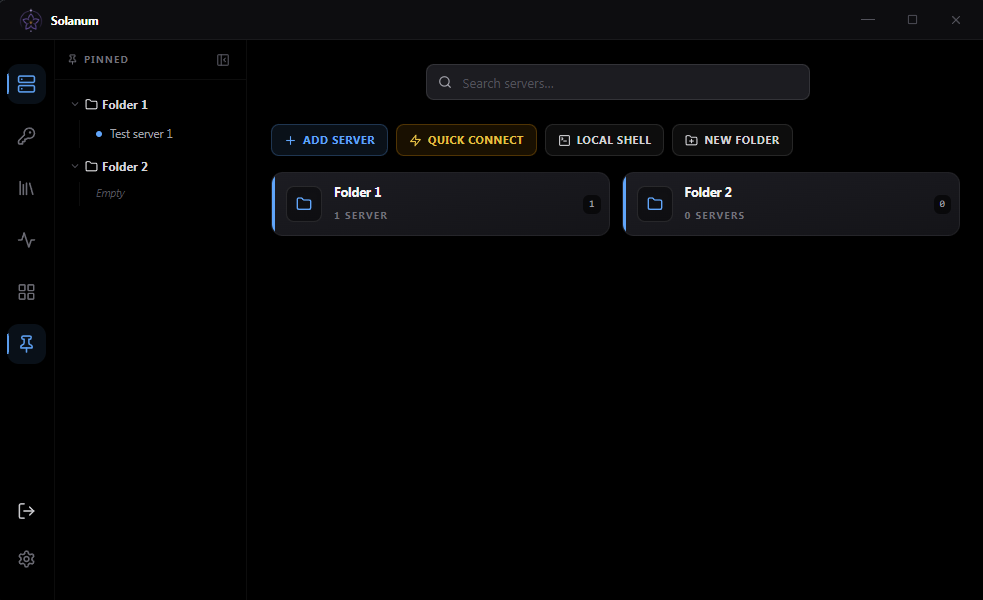
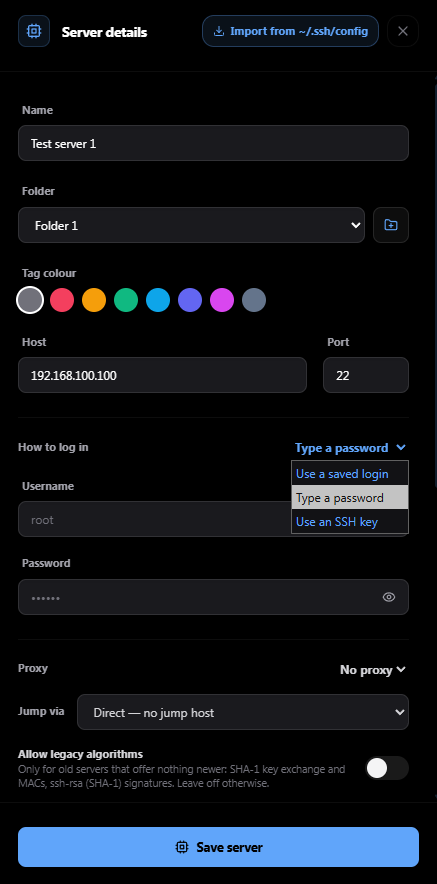
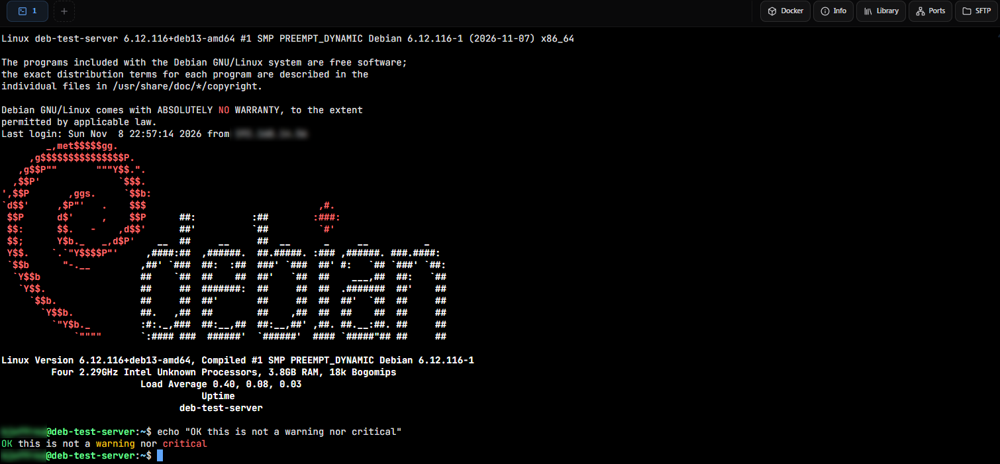
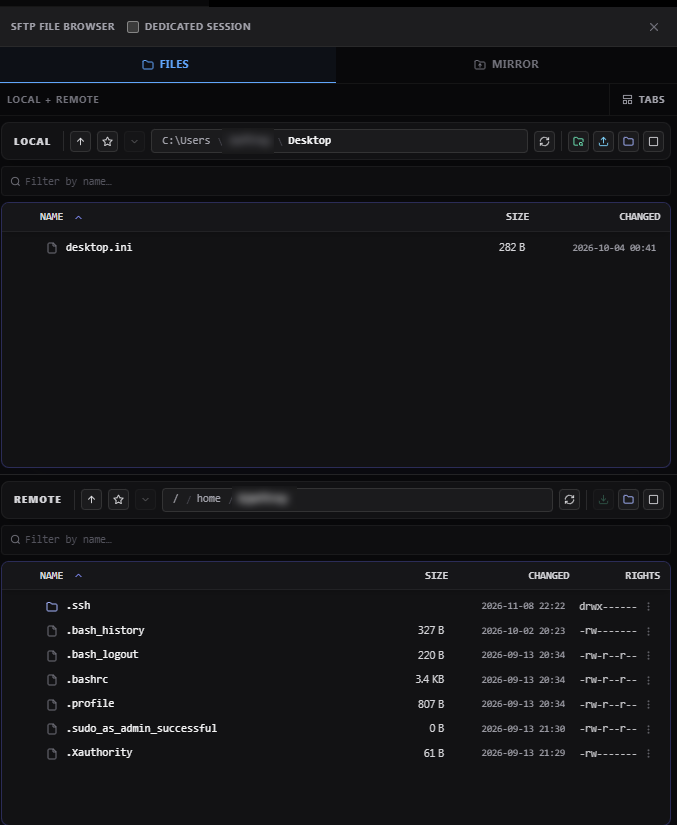
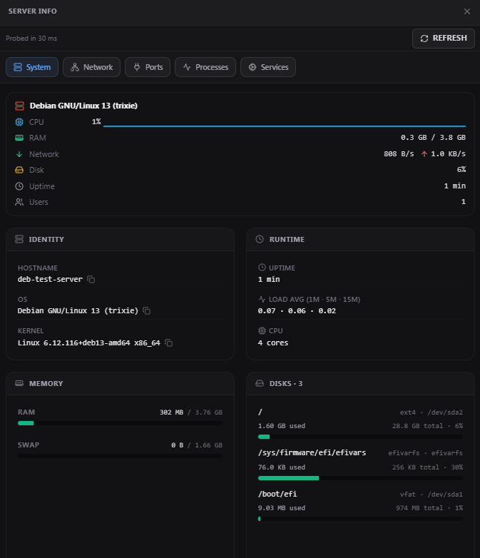
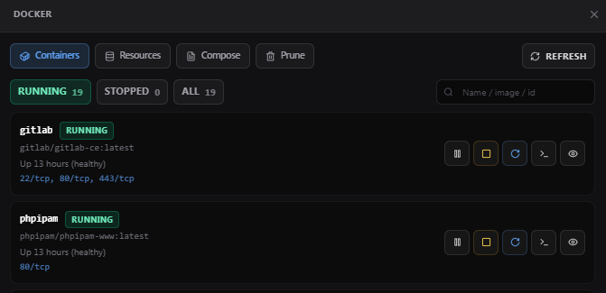
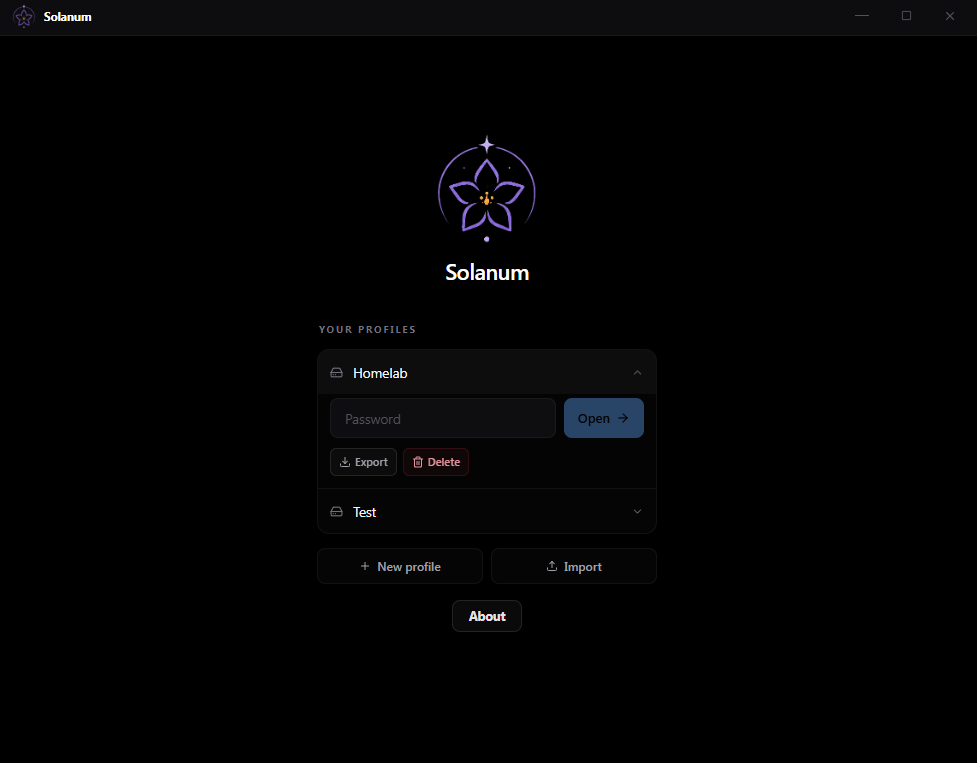

<div align="center">
  
  <h1>Solanum — Local-First SSH &amp; SFTP Client</h1>
  <p><strong>A fast, secure SSH and SFTP client for Windows, macOS, Linux and Android — with an encrypted local vault and no cloud.</strong></p>
  <p>Manage servers, edit remote files, forward ports, and sync folders from one native window. Built with Rust and Tauri.</p>
  <p>
    <a href="https://github.com/joffrey-b/solanum/releases"></a>
    <a href="https://github.com/joffrey-b/solanum/releases"></a>
    <a href="https://github.com/joffrey-b/solanum/actions"></a>
    
    
  </p>
</div>

---

Solanum is a free, open-source SSH and SFTP client. Each server gets one tabbed window: terminal, file browser, port forwarding, folder mirror, server info and Docker. It replaces the usual PuTTY + WinSCP + tunnel manager stack, and runs on Windows, macOS, Linux and Android.

> **Local only.** No account, no cloud, no sync server, no telemetry. Everything you save stays in an encrypted file on your device.

<p align="center">
  
</p>

## Highlights

- **One window per server**: terminal, SFTP, tunnels, folder mirror, Docker and live server info as tabs of the same session
- **Many servers at once**: split view for two sessions side by side, a **Wall** that shows terminals from several servers in a grid, and **broadcast input** to type into several sessions at once
- **Local shells** next to your SSH sessions: PowerShell, Command Prompt, WSL or Git Bash on Windows, your own shell on Linux and macOS
- **Network gear welcome**: Cisco switches and other devices that allow one channel per connection get a clean terminal session, and old SHA-1 algorithms can be allowed for the servers that need them
- **Encrypted vault**: your profiles are sealed with Argon2id and AES-256-GCM, on your device only
- **Host import** from an OpenSSH config, PuTTY or MobaXterm: Add server → **Import hosts**
- **Native and light**: Rust and Tauri, no bundled Chromium

## Features

More screenshots are in [docs/screenshots](docs/screenshots).

### Servers and sessions

<p align="center">
  
</p>

- Folders, colour tags and search; drag servers to reorder them, clone one to start a similar one
- **Pin** servers and folders to a side panel for quick access
- **Arrange the icon bar** on the left: drag its icons into the order you like
- **Jump hosts** and SOCKS5 or HTTP proxies, per server
- Key, password, keyboard-interactive and **two-step logins** (a key, then a password or a code)
- **Run on connect**: commands typed into the first terminal when the server connects
- **Autostart** servers when Solanum opens, and **Quick connect**: type an address and go (the server is added to your list for next time)
- **Import hosts** (Add server → Import hosts) from an OpenSSH config, PuTTY (`.reg`), MobaXterm (`.mxtsessions`) or a JSON list: each host's name, address, port and user, never a password or key
- **Terminal only**, for devices that allow one channel per connection: Solanum recognises Cisco devices by itself and offers to remember any other, so SFTP, Info and Docker step aside instead of failing
- **Local shell tabs** (desktop): your login shell or another from your system's list, PowerShell, PowerShell 7, Command Prompt, WSL or Git Bash on Windows. Each one asks first, in a system dialog
- A dropped connection reconnects by itself and keeps your scrollback. A session the server ends (`exit`, an idle logout) stays ended until you press **R** or **Reconnect**

### Terminal

<p align="center">
  
</p>

- xterm.js with true colour and mouse support; several terminals per session
- **Keyword highlighting**, MobaXterm-style: `error`, `warning`, `ok` and your own words or phrases, in the colours you choose
- **Five bundled fonts** (JetBrains Mono, Fira Code, Cascadia Code, IBM Plex Mono, Source Code Pro), cursor style, colour themes and themes of your own
- **PuTTY-style copy and paste** (select to copy, right-click to paste), or a Copy/Paste menu if you prefer
- **Careful paste**: a paste that could run commands (control characters, several lines) is shown to you first
- **Ctrl+R history search** across every server and **text-expansion snippets**, both opt-in
- **Session logs**: save a terminal's output to a file, or have every terminal write its transcript as it goes
- Scrollback of your choosing (100,000 lines by default). A flood of output does not freeze the window or the connection: past a few MiB the oldest part is skipped on screen, with a note (a session log keeps every byte)
- An optional question before closing a tab where a shell is still running

### SFTP file browser

<p align="center">
  
</p>

- Local and remote panes, one above the other or as tabs, with breadcrumbs, bookmarks and a filter
- Drag and drop between the panes and from your file manager; multi-select for bulk download, move and delete
- Transfer speed and time left, Cancel, and a question before anything is overwritten
- **Live edit**: open a remote file (up to 50 MiB) in the app your computer uses for it, and every save goes back to the server until you stop it
- **No half-written files**: transfers replace the target only once complete, keeping its permissions and owner
- Permissions and owner editor (chmod / chown)
- **Dedicated session**: SFTP and port forwarding can use an SSH connection of their own

### Folder mirror (desktop)

Keep a local folder and a server folder in sync.

- A two-way first sync compares size and content; after that, every local change goes to the server as it happens
- Choose what wins a conflict: local, remote or the newer file
- Server files keep their owner, group and permissions; editor leftovers, `.git` and `node_modules` are skipped
- **Soft delete**: removed files go to a `.solanum-trash` folder on the server instead of disappearing
- **Mass-delete pause**: more than 50 deletions in a minute, or a local folder that vanishes, pauses deletions until you resume
- A preview before each start shows what would change

### Server info

<p align="center">
  
</p>

The session's server at a glance, without typing a command: system overview with a live strip, network interfaces, routes and firewall rules, listening ports, processes (with Kill) and systemd services (Start, Stop, Restart). Actions retry with `sudo -n` when permission is denied.

### Docker

<p align="center">
  
</p>

Containers (start, stop, restart, pause), live logs, stats, inspect and compose files; images, volumes and networks; and a shell in any container as a new tab. Prune lists what it would remove and asks first; named volumes and tagged images are never pruned. Commands fall back to `sudo -n docker` when permission is denied.

### Port forwarding

- Local (`-L`), remote (`-R`) and dynamic (`-D`) tunnels, saved with the server and started when it connects
- The dynamic tunnel is a SOCKS4, SOCKS5 and HTTP proxy
- Tunnels listen on loopback unless you give another address, and Solanum asks before one listens beyond it
- A tunnelled connection idle for 15 minutes is closed; the tunnel keeps listening, so the program just reconnects

### Logins, library and monitoring

- Saved passwords and SSH keys: OpenSSH, PEM or PuTTY `.ppk`, with or without a passphrase. Generate a new Ed25519 key in one click
- **Library**: commands, snippets and notes, at hand in every session
- **Resource monitor**: live CPU, RAM, disk and network graphs for the servers you choose (their host key must already be trusted; a monitor stops after three refused logins, so a server does not lock you out)
- Host keys are pinned on first use, with a red warning if one changes

### Encrypted profiles

<p align="center">
  
</p>

- A profile is one password-protected file holding your servers, logins, keys, commands and notes
- **Export** and **Import** move a profile between computers and phones; the file stays encrypted
- The profile as it was when you unlocked it is kept as `<name>.solanum.bak`: close Solanum and rename it to `<name>.solanum` to undo a session
- A profile opens in one window at a time, so two windows never overwrite each other's changes

## Install

Pick a file from the [latest release](https://github.com/joffrey-b/solanum/releases); nothing else to install.

| OS | File |
|---|---|
| Windows 10 / 11 | `.exe` installer or `.msi` |
| macOS on Apple Silicon (Intel Macs are not supported) | `.dmg` or `.app.zip` |
| Debian / Ubuntu / Mint | `.deb` — `sudo apt install ./Solanum_*.deb` |
| Fedora / RHEL / openSUSE | `.rpm` — `sudo dnf install ./Solanum-*.rpm` |
| Arch / Manjaro / EndeavourOS | `.pkg.tar.zst` — `sudo pacman -U solanum-*.pkg.tar.zst` |
| Any Linux | `.AppImage` — `chmod +x` and run it (without the WebKit sandbox, see [Security](#security)) |
| Android 7.0+ | `.apk` — sideload, no Play Store needed |

The Windows and macOS builds are not code-signed. On Windows, SmartScreen asks: click **More info → Run anyway**. On macOS you may need `xattr -d com.apple.quarantine /Applications/Solanum.app`.

The APK is signed with the project's own key, the same for every release, so updates install over the previous version. Its certificate is `CN=joffrey-b`, SHA-256 `26884290e5444c83654e2d32bab821b3c50b5aa0dfc4487882b4afaac53cf6e1`; check it with `apksigner verify --print-certs <file>.apk` (Android SDK build-tools). Sideloading needs "Install unknown apps" for the app you install it from.

The AppImage carries libraries of the system that built it (WebKitGTK, GTK and what they need, mostly LGPL). `usr/share/doc/solanum/APPIMAGE-LIBRARIES.txt` inside it lists them with their licences, and the release's `.AppImage.sources.tar` holds their source.

#### Verifying a download

Each release has a `SHA256SUMS` file and a build-provenance attestation, both made by the workflow that built it. They show that a file is the one published and that this repository's release workflow built it. They do not replace code signing.

```bash
sha256sum -c SHA256SUMS --ignore-missing               # Linux (macOS: shasum -a 256 -c SHA256SUMS --ignore-missing)
gh attestation verify <file> --repo joffrey-b/solanum  # needs the GitHub CLI
```

On Windows, compare the output of `Get-FileHash <file>` with the file's line in `SHA256SUMS`.

### Android

The same Rust core, SSH stack and vault format as on the desktop, for phones, tablets and ChromeOS (Android 7.0 or later).

- A key bar above the keyboard with Ctrl, Alt, Shift, Esc and Tab (tap to arm, tap twice to lock)
- Sessions and their tunnels stay open in the background, with a notification while a session tab is open. Back sends Solanum to the background; swiping it away from Recents ends its sessions. If they drop anyway, exempt Solanum from battery optimisation
- Hidden from screenshots and the Recents preview by default (Settings > Terminal)
- **Import** and **Export** go through Android's own file screens. Export is a phone profile's only backup: Android's backup is off for Solanum, and uninstalling it deletes its profiles
- No folder mirror or local shell on Android

## Security

- Profiles are encrypted on your device with Argon2id and AES-256-GCM. The key is in memory only while a profile is unlocked, and is wiped when you lock it or quit
- Host keys are pinned on first use. SHA-1 algorithms are refused unless you allow them for a server
- What a server sends is treated as untrusted: file names cannot leave the folder you download to, programs are never opened, and opening a file or starting a local shell asks first in a system dialog
- On Linux the window runs in WebKit's sandbox where the system allows it (the `.deb`, `.rpm` and Arch packages on a normal desktop; not the AppImage)

**What leaves your machine:** your SSH connections, to the hosts you configured, and one anonymous request to GitHub's releases API to see whether a newer version exists, once per launch and when you press **Check for updates** in About. It sends nothing from your vault; GitHub sees your IP address, the time and the version asking. It cannot be turned off, but blocking it affects nothing else. Installing on Windows can add one connection: where Microsoft's WebView2 runtime is missing (some Windows 10 installs), the installer downloads it from Microsoft ([details](SECURITY.md#known-limitations)).

[SECURITY.md](SECURITY.md) has the rest: how to report a vulnerability, what Solanum protects and what it does not, its defences in detail, and its **known limitations**.

## FAQ

### Is Solanum free?

Yes. It is free software under the GNU GPL v3: use it personally or at work, study and change it, and share it, as long as whoever you give it to also gets the source under the same licence.

### An old server stopped connecting. What changed?

Solanum refuses SHA-1 algorithms by default (key exchange `diffie-hellman-group1-sha1` / `-group14-sha1`, HMAC-SHA1, `ssh-rsa` signatures). The error names what the server offered. If you trust that server, edit it and turn on **Allow legacy algorithms**; it applies to that server only. A Quick connect target is in your server list: edit it there.

### Why are SFTP, Info and Docker greyed out on my switch or router?

Some network devices allow one channel per connection, and the terminal uses it. Solanum recognises Cisco devices by what they announce, and any other such host when it refuses a second channel: the session stays a plain terminal and a notice offers to remember this. **Terminal only** in a server's settings does the same from the start.

### Where are my profiles stored?

Each profile is one encrypted file in your system's app-data folder; your servers, logins and keys are nowhere else. What stays outside it holds no password or key: the window's own settings (per profile: last folders, bookmarks, layout), session logs if you turn them on, and the local copy of a file while you live-edit it.

### I used the original Submarine. Can I bring my profiles over?

No, by design: Solanum has its own profile format and does not open the original cloud-enabled Submarine's files (it says so and leaves the file untouched). Start a new profile and enter your hosts again, or, if you also have them in an OpenSSH config, PuTTY or MobaXterm, import them from there: Add server → **Import hosts**.

### Is Solanum on the Play Store?

No. The APK is on the [releases page](https://github.com/joffrey-b/solanum/releases).

## Build from source

You need Node 22.12 or newer, Rust 1.89 or newer, and the [Tauri prerequisites](https://v2.tauri.app/start/prerequisites/) for your system. The SSH stack is pure Rust, so there is no OpenSSL or Perl to install.

```bash
git clone https://github.com/joffrey-b/solanum
cd solanum
npm install
npm run tauri dev          # run in development
npm run tauri build        # build the installers
```

[docs/BUILDING.md](docs/BUILDING.md) covers the Android build, signing an APK, the tests and CI.

Built with React 18, TypeScript, Tailwind CSS and xterm.js for the window, and Rust, Tauri 2, russh, rusqlite, aes-gcm, argon2 and zstd underneath.

## Contributing

Bug reports and feature requests are welcome as [GitHub issues](https://github.com/joffrey-b/solanum/issues). Pull requests are not taken for now: development happens in another repository, and each release is published here as a single commit. For a security problem, please use the private reporting described in [SECURITY.md](SECURITY.md) rather than an issue.

## Credits

Solanum is a fork of [Submarine](https://github.com/SinaXhpm/Submarine) by Sina Xhpm (MIT-licensed; see [NOTICE](NOTICE)). The changes in this fork — removing the cloud feature, the security hardening, the new features, name and identity — were made by joffrey-b in collaboration with Anthropic's [Claude](https://claude.com/claude-code).

## License

GNU General Public License v3.0 only (`GPL-3.0-only`) — see [LICENSE](LICENSE). Solanum comes with no warranty.

Solanum began as a fork of Submarine by Sina Xhpm, which is MIT-licensed. The original copyright and permission notice are kept in [NOTICE](NOTICE), as the MIT License requires. The original project's name and logo are its author's marks and are not part of what is licensed here.

The licences of everything Solanum is built from, the bundled fonts included, are in [THIRD-PARTY-LICENSES.txt](THIRD-PARTY-LICENSES.txt). All three files ship with every build and can be read in the app, under **About > View licences**.
